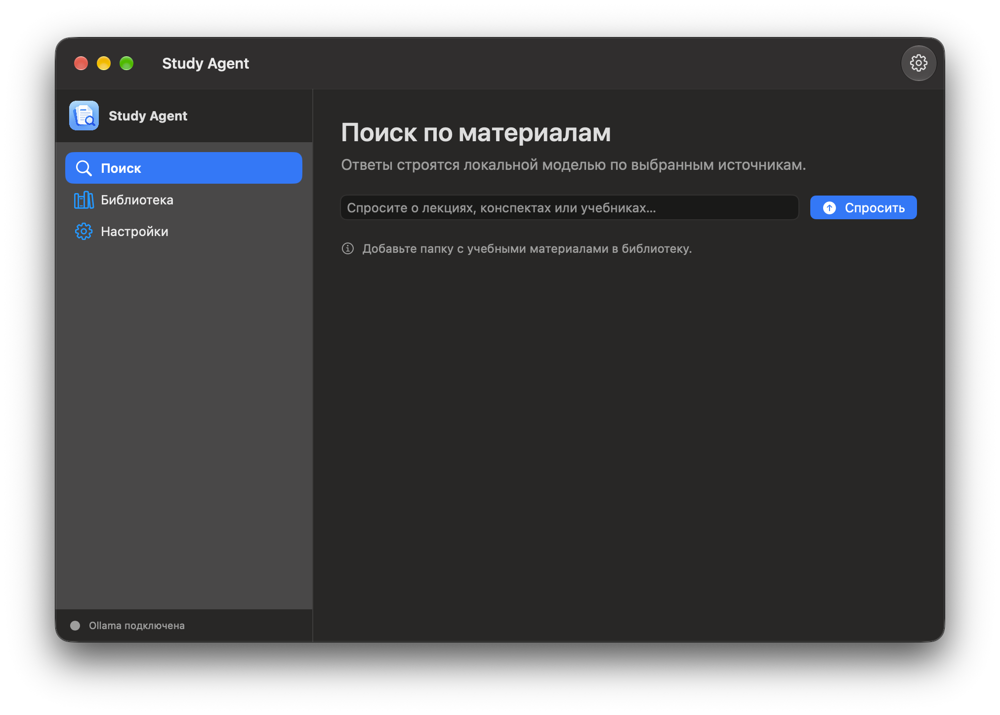
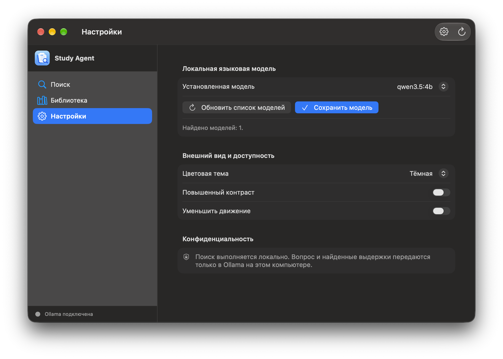

# Study Agent

Study Agent помогает искать в выбранных учебных материалах и получать локальные ответы по найденным фрагментам.

> **Последний выпуск:** [Study Agent v1 Beta 2](https://github.com/gregkorneev-BMSTU/study-agent/releases/tag/v1.0.0-beta.2) — тестовая версия для macOS 14+ на Apple Silicon. DMG ad-hoc подписан и не нотариализован Apple, поэтому Gatekeeper может блокировать запуск. DOCX, постоянный индекс, Windows-сборка и нотариализация ещё не готовы.

## Скачать

[Скачать StudyAgent-v1.0.0-beta.2-macos-arm64.dmg](https://github.com/gregkorneev-BMSTU/study-agent/releases/download/v1.0.0-beta.2/StudyAgent-v1.0.0-beta.2-macos-arm64.dmg) · [Release notes на русском и английском](https://github.com/gregkorneev-BMSTU/study-agent/releases/tag/v1.0.0-beta.2).

Откройте DMG и перетащите **Study Agent.app** в **Applications**. При первом запуске мастер проверит компоненты и предложит установить Ollama и локальную модель; Chandra OCR можно установить отдельно из настроек. Для проверки файла DMG используйте SHA-256 из release notes.

## Предпросмотр

Актуальная версия для macOS — нативное приложение SwiftUI/Xcode с фирменной иконкой Study Agent. Скриншоты показывают поиск, библиотеку с пустым состоянием по центру рабочей области и настройки. Мастер первого запуска и оформление DMG входят в Beta 2, но на этих снимках не показаны.

<p align="center">
  
</p>

| Поиск · тёмная тема | Библиотека · тёмная тема |
| --- | --- |
|  |  |

| Настройки · тёмная тема |
| --- |
|  |

## Что планируется

- Постоянный индекс и автоматическое обновление при изменении выбранных папок.
- Поддержка DOCX и локальные эмбеддинги для семантического поиска и RAG.
- Точность ссылок на страницы, расширенная проверка ответов по источникам и измерения качества OCR.
- Проверенная Windows-сборка и обычная macOS-дистрибуция с Developer ID и нотариализацией.
- Новые источники, включая материалы IU5Hub по явному выбору пользователя, и ограниченные MCP-инструменты.

## Что уже есть

- Python-пакет `study_agent` и базовая конфигурация разработки.
- Подключение выбранных папок и поиск по `.txt`, `.md`, PDF с текстовым слоем и изображениям. Chandra OCR работает локально; Beta 2 умеет явно скачать модель из настроек.
- CI с проверками pytest и Ruff на Python 3.12 и 3.13.
- Нативное приложение macOS с поиском, библиотекой, настройками, меню приложения и menu bar, системным выбором папок и открытием найденного исходного файла.
- Русский и английский интерфейс, светлая и тёмная темы, повышенный контраст и уменьшение движения.
- Мастер первого запуска: диагностика системы, встроенного backend, Ollama и моделей; открытие установленной Ollama или её официальной страницы; загрузка Qwen 3.5 4B через локальный API с реальным прогрессом и отменой. Мастер можно открыть повторно из настроек.
- Локальные ответы через Ollama по найденным фрагментам. Документы не отправляются в облачные модели. Поиск доступен и без установленной LLM, но генерация ответа требует Ollama и локальной модели.
- Опциональная установка Chandra OCR из мастера «Компоненты и диагностика» с прогрессом и отменой. Модель размером около 10,6 ГБ загружается в локальные данные приложения; документы не отправляются.
- Запуск интерфейса для разработки: `python -m study_agent`.
- Архитектурная документация и поэтапный план реализации.

## Нативное приложение macOS (Xcode)

Откройте `macOS/StudyAgent.xcodeproj` в Xcode или соберите автономный `~/Applications/Study Agent.app` из корня репозитория:

```sh
python3.12 -m venv .venv
.venv/bin/python -m pip install '.[packaging,ocr]'
./scripts/build_macos_native_app.sh
open "$HOME/Applications/Study Agent.app"
```

SwiftUI отвечает за macOS UI и системные сценарии. Python backend упакован отдельным PyInstaller helper внутри `.app` и переиспользует логику поиска и Ollama. Python и PySide6 отдельно устанавливать пользователю не нужно. Сборку выполнять на macOS с Xcode Command Line Tools и локальным `.venv`; по умолчанию `.app` создаётся в `~/Applications`, каталог можно переопределить переменной `APP_OUTPUT_DIR`. Для разработки DMG собирается командой `./scripts/build_macos_dmg.sh --mode development --suffix beta.2`; процедура подписи Developer ID и нотариализации описана в [Wiki](wiki/macos-release.md). Минимальная версия macOS — 14.

Интерфейс нативного приложения доступен на русском и английском. Язык выбирается в **Настройки → Внешний вид и доступность → Язык интерфейса**, сохраняется на этом компьютере и применяется сразу. Если язык ещё не выбирали, приложение использует язык macOS (русский или английский; для остальных языков — английский). Локальная модель получает тот же выбранный язык для ответа.

## PySide6 и Windows

PySide6 GUI сохранён как кроссплатформенный путь разработки и для будущей Windows-сборки. Запуск в активированном Python окружении: `python -m study_agent`. Для macOS используется только Xcode-сборка выше.

Полный предоставленный графический комплект хранится в [`assets/StudyAgent_Apple_Icon_Kit`](assets/StudyAgent_Apple_Icon_Kit). Xcode-проект ссылается прямо на ICNS и PNG внутри комплекта, чтобы не хранить их дубликаты.

## Установка для разработки

Требуется Python 3.12 или новее.

```sh
git clone https://github.com/gregkorneev-BMSTU/study-agent.git
cd study-agent
python3.12 -m venv .venv
```

Активируйте окружение:

```sh
# macOS / Linux
source .venv/bin/activate

# Windows PowerShell
.venv\Scripts\Activate.ps1
```

Установите зависимости разработки и запустите проверки:

```sh
python -m pip install '.[dev]'
pytest
ruff check .
```

Запустите PySide6-интерфейс в активированном окружении командой `python -m study_agent`. Проверки не загружают модели и не обращаются к пользовательским папкам. Для локальных ответов нужно отдельно установить и запустить Ollama.

Если на macOS при запуске появляется ошибка Qt `Could not find the Qt platform plugin "cocoa"`, из корня проекта активируйте `.venv` и восстановите совместимую ветку Qt:

```sh
source .venv/bin/activate
python -m pip install --force-reinstall --no-cache-dir 'PySide6-Essentials>=6.10.3,<6.11'
```

## Установить локальную модель

Для первого запуска интерфейса установите Ollama и локальную модель `qwen3.5:4b`:

- **macOS:** мастер Study Agent проверит Ollama, откроет её [официальную страницу](https://ollama.com/download), если она отсутствует, и предложит загрузить `qwen3.5:4b` из приложения после запуска Ollama. Terminal для этого сценария не нужен.
- **Windows:** установите Ollama с [официальной страницы](https://ollama.com/download/windows), затем в PowerShell выполните `ollama pull qwen3.5:4b`.

Проверить загрузку можно командами `ollama list` и `ollama run qwen3.5:4b`. Модель хранится в Ollama отдельно от проекта и выбирается в разделе «Настройки». См. [Wiki: установка моделей](wiki/model-setup.md).

## Локальные данные и конфиденциальность

Приложение проектируется так, чтобы пользователь сам выбирал папки с материалами. Код не должен зависеть от путей разработчика. Исходные документы, индексы, кэш и модели не следует добавлять в Git. Тестовые данные должны быть синтетическими или обезличенными.

Целевой режим обработки документов и генерации ответов — локальный. Приложение обращается к Ollama на этом компьютере и не использует облачный fallback. Учебные файлы открываются только из папок, которые пользователь явно добавил. Подробности см. в Wiki.

Для локального OCR в окружении разработки установите дополнительную группу `ocr` командой `python -m pip install '.[ocr]'`. Сканированные PDF и изображения обрабатываются Chandra на компьютере. Веса не входят в Git или DMG. В Beta 2 откройте **Настройки → Компоненты и диагностика** и нажмите **Установить Chandra OCR**; скачивание запускается только после нажатия. Цифровой текстовый слой PDF извлекается напрямую. Лицензия, закреплённая ревизия и ограничения описаны в [инструкции Chandra](wiki/chandra-ocr.md).

## План разработки

1. Добавить постоянный индекс и автоматическое обновление изменений в выбранных папках.
2. Добавить DOCX и локальные эмбеддинги; откалибровать качество и ресурсы подключённого Chandra OCR.
3. Улучшить ответы RAG, точность ссылок на страницы и обработку недостатка источников.
4. Проверить интерфейс и сборку на Windows; подписать и нотариализовать DMG для обычного распространения на macOS, подготовить установщик Windows.
5. Реализовать дополнительные источники и MCP-инструменты после стабилизации основного потока.

## Документация

- [Wiki проекта](wiki/README.md)
- [Требования](wiki/requirements.md)
- [Архитектура](wiki/architecture.md)
- [Дорожная карта](wiki/roadmap.md)
- [Текущее состояние](wiki/current-state.md)
- [Установка моделей](wiki/model-setup.md)
- [Локальный Chandra OCR](wiki/chandra-ocr.md)
- [Решения и открытые вопросы](wiki/decisions/README.md)
- [Тестирование и CI](wiki/testing.md)
- [macOS Beta: установка и выпуск](wiki/macos-release.md)
