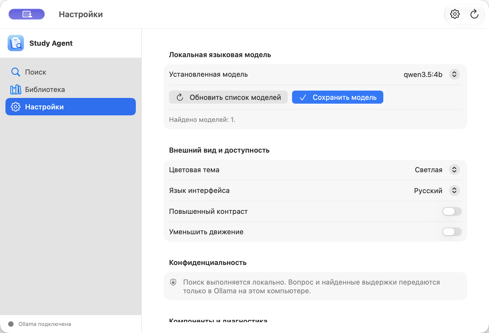

# Study Agent

[](LICENSE) · **Free & Open Source**

Study Agent помогает искать в выбранных учебных материалах и получать локальные ответы по найденным фрагментам.

Собственный исходный код Study Agent распространяется по MIT License. Приложение ориентировано на локальную обработку материалов; библиотеки, OCR/LLM-модели и графические материалы могут иметь отдельные условия. См. [LICENSE](LICENSE) и [THIRD_PARTY_NOTICES.md](THIRD_PARTY_NOTICES.md).

> **Последний опубликованный выпуск:** [Study Agent v1 Beta 3](https://github.com/gregkorneev-BMSTU/study-agent/releases/tag/v1.0.0-beta.3) — macOS 14+ для Apple Silicon, версия 1.0.0 (build 3). DMG ad-hoc подписан и не нотариализован Apple, поэтому Gatekeeper может блокировать запуск. В `main` после Beta 3 вошли постоянный индекс, поддержка DOCX и нативный экран индексации macOS; опубликованный Beta 3 DMG этих изменений не содержит. Windows-сборка и нотариализация ещё не готовы.

## Скачать

[Скачать StudyAgent-v1.0.0-beta.3-macos-arm64.dmg](https://github.com/gregkorneev-BMSTU/study-agent/releases/download/v1.0.0-beta.3/StudyAgent-v1.0.0-beta.3-macos-arm64.dmg) · [Release notes на русском и английском](https://github.com/gregkorneev-BMSTU/study-agent/releases/tag/v1.0.0-beta.3) · [SHA-256](https://github.com/gregkorneev-BMSTU/study-agent/releases/download/v1.0.0-beta.3/StudyAgent-v1.0.0-beta.3-macos-arm64.dmg.sha256).

Откройте DMG и перетащите **Study Agent.app** в **Applications**. При первом запуске мастер проверит компоненты и предложит установить Ollama и локальную модель; Chandra OCR можно установить отдельно из настроек. Для проверки файла DMG используйте SHA-256 из release notes.

## Предпросмотр

Актуальная версия для macOS — нативное приложение SwiftUI/Xcode с фирменной иконкой Study Agent. Это реальные снимки приложения **v1 Beta 3 (build 3)**: поиск и библиотека в тёмной теме, а настройки — в тёмной и светлой темах. Навигация и системные материалы оформляются средствами macOS.

<p align="center">
  
</p>

| Поиск · тёмная тема | Библиотека · тёмная тема |
| --- | --- |
|  |  |

| Настройки · тёмная тема | Настройки · светлая тема |
| --- | --- |
|  |  |

## Что планируется

- Автоматическое наблюдение за изменениями файлов без запуска поиска или повторного открытия приложения.
- Локальные эмбеддинги для семантического поиска и RAG.
- Точность ссылок на страницы, расширенная проверка ответов по источникам и измерения качества OCR.
- Проверенная Windows-сборка и обычная macOS-дистрибуция с Developer ID и нотариализацией.
- Новые источники, включая материалы IU5Hub по явному выбору пользователя, и ограниченные MCP-инструменты.

## Что уже есть

- Python-пакет `study_agent` и базовая конфигурация разработки.
- Постоянный локальный SQLite-индекс с инкрементальным обновлением при добавлении папки и проверке изменений; обычный поиск читает сохранённые фрагменты без повторного извлечения неизменённых документов. Подробности: [индексация документов](wiki/document-indexing.md).
- Подключение выбранных папок и поиск по `.txt`, `.md`, DOCX и PDF с текстовым слоем. Chandra OCR runtime входит в Beta 3; обработка сканов и изображений требует отдельно загруженных весов модели.
- CI с проверками pytest и Ruff на Python 3.12 и 3.13.
- Нативное приложение macOS на SwiftUI с `NavigationSplitView`, поиском, библиотекой, настройками, системными меню и пунктом menu bar, выбором папок через macOS и открытием исходного файла из результата.
- Нативная библиотека macOS показывает очередь и прогресс индексации, статистику документов и фрагментов из SQLite, сохранённые ошибки, отмену и повторную проверку изменений. После перезапуска приложение восстанавливает предупреждения документов.
- Ответ локальной модели сопровождается использованными фрагментами с доступными страницами PDF и заголовками DOCX. Для PDF показывается номер страницы, а файл открывается системным приложением.
- Первое знакомство из трёх экранов, затем мастер подготовки и диагностика в той же панели; знакомство можно открыть повторно через меню «Справка».
- Штатный системный Liquid Glass для навигации и управления. Приложение не добавляет отдельную панель или ползунок интенсивности и не меняет системную настройку внешнего вида.
- Русский и английский интерфейс, светлая и тёмная темы, повышенный контраст и уменьшение движения.
- Мастер первого запуска: диагностика системы, встроенного backend, Ollama и моделей; открытие установленной Ollama или её официальной страницы; загрузка Qwen 3.5 4B через локальный API с реальным прогрессом и отменой. Мастер можно открыть повторно из настроек.
- Локальные ответы через Ollama по найденным фрагментам. Документы не отправляются в облачные модели. Поиск доступен и без установленной LLM, но генерация ответа требует Ollama и локальной модели.
- Chandra OCR runtime встроен в macOS helper. Веса модели размером около 10,6 ГБ не входят в DMG и отдельно загружаются через «Компоненты и диагностика»; загрузка начинается только после нажатия. Диагностика Beta 3 подтвердила наличие runtime и отсутствие весов. OCR inference с загруженными весами в этой сборке не проверялся.
- Встроенная в приложение MIT-лицензия проекта и уведомления о сторонних Python-компонентах.

- В Beta 3 содержимое интерфейса доступно на русском и английском, но стандартные заголовки системного меню File/Edit/View/Window/Help пока следуют языку macOS, а не выбранному языку приложения.
- Запуск интерфейса для разработки: `python -m study_agent`.
- Архитектурная документация и поэтапный план реализации.

## Нативное приложение macOS (Xcode)

Откройте `macOS/StudyAgent.xcodeproj` в Xcode или соберите автономный `~/Applications/Study Agent.app` из корня репозитория:

```sh
python3.12 -m venv .venv
.venv/bin/python -m pip install '.[packaging,ocr]'
./scripts/build_macos_native_app.sh
open "$HOME/Applications/Study Agent.app"
```

SwiftUI отвечает за macOS UI и системные сценарии. Python backend упакован отдельным PyInstaller helper внутри `.app` и переиспользует логику поиска и Ollama. Python и PySide6 отдельно устанавливать пользователю не нужно. Сборку выполнять на macOS с Xcode Command Line Tools и локальным `.venv`; по умолчанию `.app` создаётся в `~/Applications`, каталог можно переопределить переменной `APP_OUTPUT_DIR`. Для разработки DMG собирается командой `./scripts/build_macos_dmg.sh --mode development --suffix beta.3`; процедура подписи Developer ID и нотариализации описана в [Wiki](wiki/macos-release.md). Минимальная версия macOS — 14.

Интерфейс нативного приложения доступен на русском и английском. Язык выбирается в **Настройки → Внешний вид и доступность → Язык интерфейса**, сохраняется на этом компьютере и применяется сразу к интерфейсу приложения. Если язык ещё не выбирали, приложение использует язык macOS (русский или английский; для остальных языков — английский). Локальная модель получает тот же выбранный язык для ответа.

## PySide6 и Windows

PySide6 GUI сохранён как кроссплатформенный путь разработки и для будущей Windows-сборки. Запуск в активированном Python окружении: `python -m study_agent`. Для macOS используется только Xcode-сборка выше.
PySide6 начинает индексацию в фоне сразу после добавления папки. Поиск ждёт завершения текущих операций с библиотекой и обновляет изменённые документы; удаление папки очищает её записи из локального индекса.

Полный предоставленный графический комплект хранится в [`assets/StudyAgent_Apple_Icon_Kit`](assets/StudyAgent_Apple_Icon_Kit). Xcode-проект ссылается прямо на ICNS и PNG внутри комплекта, чтобы не хранить их дубликаты.

## Установка для разработки

Требуется Python 3.12 или новее.

```sh
git clone https://github.com/gregkorneev-BMSTU/study-agent.git
cd study-agent
python3.12 -m venv .venv
```

Активируйте окружение:

```sh
# macOS / Linux
source .venv/bin/activate

# Windows PowerShell
.venv\Scripts\Activate.ps1
```

Установите зависимости разработки и запустите проверки:

```sh
python -m pip install '.[dev]'
pytest
ruff check .
```

Запустите PySide6-интерфейс в активированном окружении командой `python -m study_agent`. Проверки не загружают модели и не обращаются к пользовательским папкам. Для локальных ответов нужно отдельно установить и запустить Ollama.

Если на macOS при запуске появляется ошибка Qt `Could not find the Qt platform plugin "cocoa"`, из корня проекта активируйте `.venv` и восстановите совместимую ветку Qt:

```sh
source .venv/bin/activate
python -m pip install --force-reinstall --no-cache-dir 'PySide6-Essentials>=6.10.3,<6.11'
```

## Установить локальную модель

Для первого запуска интерфейса установите Ollama и локальную модель `qwen3.5:4b`:

- **macOS:** мастер Study Agent проверит Ollama, откроет её [официальную страницу](https://ollama.com/download), если она отсутствует, и предложит загрузить `qwen3.5:4b` из приложения после запуска Ollama. Terminal для этого сценария не нужен.
- **Windows:** установите Ollama с [официальной страницы](https://ollama.com/download/windows), затем в PowerShell выполните `ollama pull qwen3.5:4b`.

Проверить загрузку можно командами `ollama list` и `ollama run qwen3.5:4b`. Модель хранится в Ollama отдельно от проекта и выбирается в разделе «Настройки». См. [Wiki: установка моделей](wiki/model-setup.md).

## Локальные данные и конфиденциальность

Приложение проектируется так, чтобы пользователь сам выбирал папки с материалами. Код не должен зависеть от путей разработчика. Исходные документы, индексы, кэш и модели не следует добавлять в Git. Тестовые данные должны быть синтетическими или обезличенными.

Целевой режим обработки документов и генерации ответов — локальный. Приложение обращается к Ollama на этом компьютере и не использует облачный fallback. Учебные файлы открываются только из папок, которые пользователь явно добавил. Подробности см. в Wiki.

Для локального OCR в окружении разработки установите дополнительную группу `ocr` командой `python -m pip install '.[ocr]'`. Веса Chandra не входят в Git или DMG. В Beta 3 откройте **Настройки → Компоненты и диагностика** и нажмите **Установить Chandra OCR**; скачивание запускается только после нажатия. Цифровой текстовый слой PDF извлекается напрямую. Перед загрузкой весов проверьте их отдельную лицензию и ограничения в [инструкции Chandra](wiki/chandra-ocr.md).

## План разработки

1. Добавить постоянный индекс и автоматическое обновление изменений в выбранных папках.
2. Добавить DOCX и локальные эмбеддинги; откалибровать качество и ресурсы подключённого Chandra OCR.
3. Улучшить ответы RAG, точность ссылок на страницы и обработку недостатка источников.
4. Проверить интерфейс и сборку на Windows; подписать и нотариализовать DMG для обычного распространения на macOS, подготовить установщик Windows.
5. Реализовать дополнительные источники и MCP-инструменты после стабилизации основного потока.

## Документация

- [Wiki проекта](wiki/README.md)
- [Требования](wiki/requirements.md)
- [Архитектура](wiki/architecture.md)
- [Дорожная карта](wiki/roadmap.md)
- [Текущее состояние](wiki/current-state.md)
- [Установка моделей](wiki/model-setup.md)
- [Локальный Chandra OCR](wiki/chandra-ocr.md)
- [Решения и открытые вопросы](wiki/decisions/README.md)
- [Тестирование и CI](wiki/testing.md)
- [macOS Beta: установка и выпуск](wiki/macos-release.md)

## Лицензия

Собственный исходный код Study Agent, созданный Gregory Korneev, распространяется по [MIT License](LICENSE). Лицензия разрешает использовать, изменять и распространять этот код, в том числе в коммерческих целях, при сохранении уведомления об авторских правах и текста лицензии.

MIT не распространяется автоматически на сторонние библиотеки, модели и визуальные материалы. В частности, веса Chandra OCR 2 имеют отдельную Modified OpenRAIL-M лицензию; приложение не включает их в репозиторий или DMG и предлагает загрузить их отдельно. Условия моделей, загружаемых через Ollama, также определяются лицензией конкретной модели. Перечень компонентов и текущие ограничения аудита приведены в [THIRD_PARTY_NOTICES.md](THIRD_PARTY_NOTICES.md).

The Study Agent source code authored by Gregory Korneev is distributed under the MIT License. Third-party software, model weights, and visual assets remain subject to their own terms; see [THIRD_PARTY_NOTICES.md](THIRD_PARTY_NOTICES.md).
