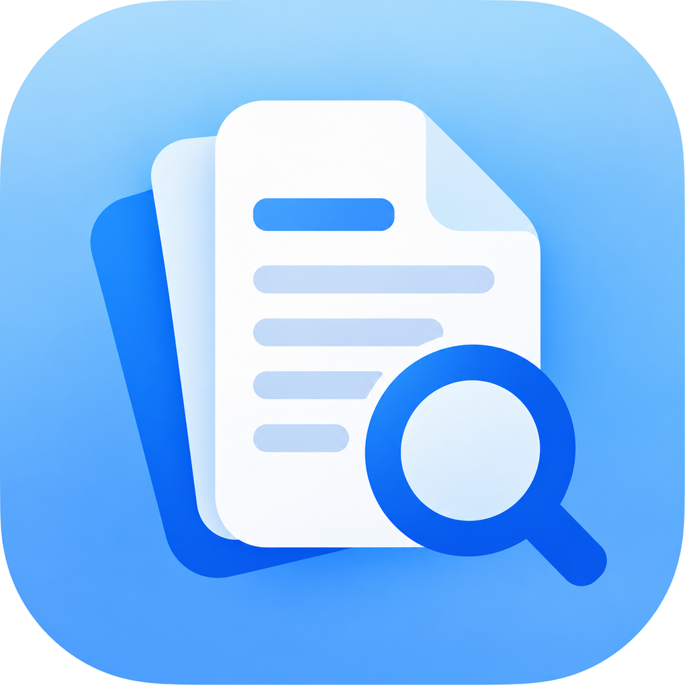
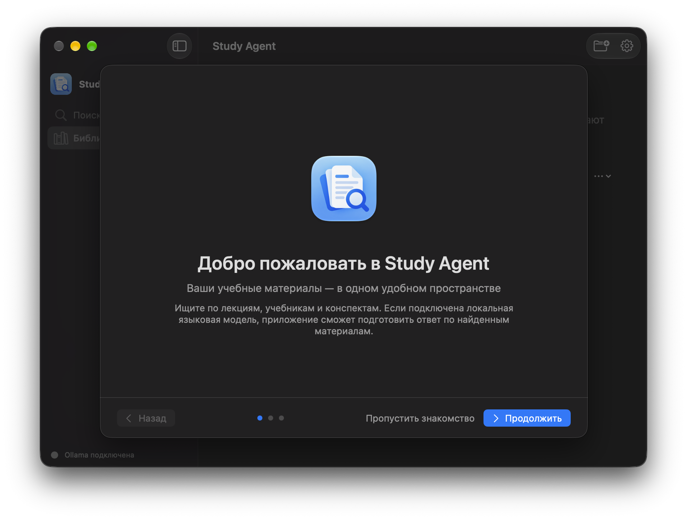
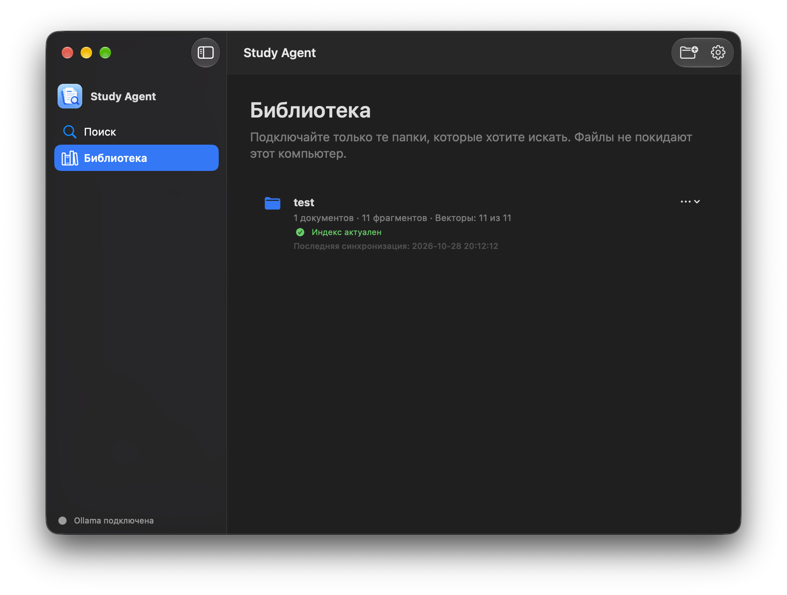
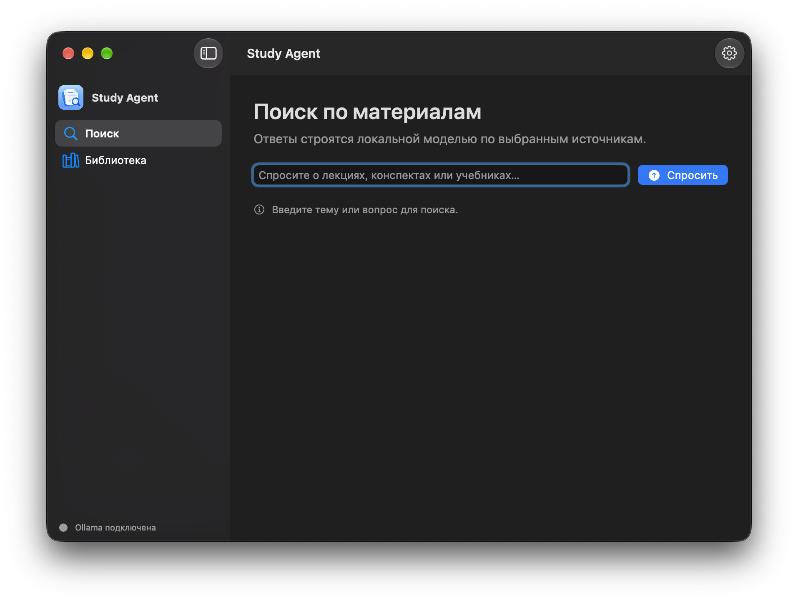
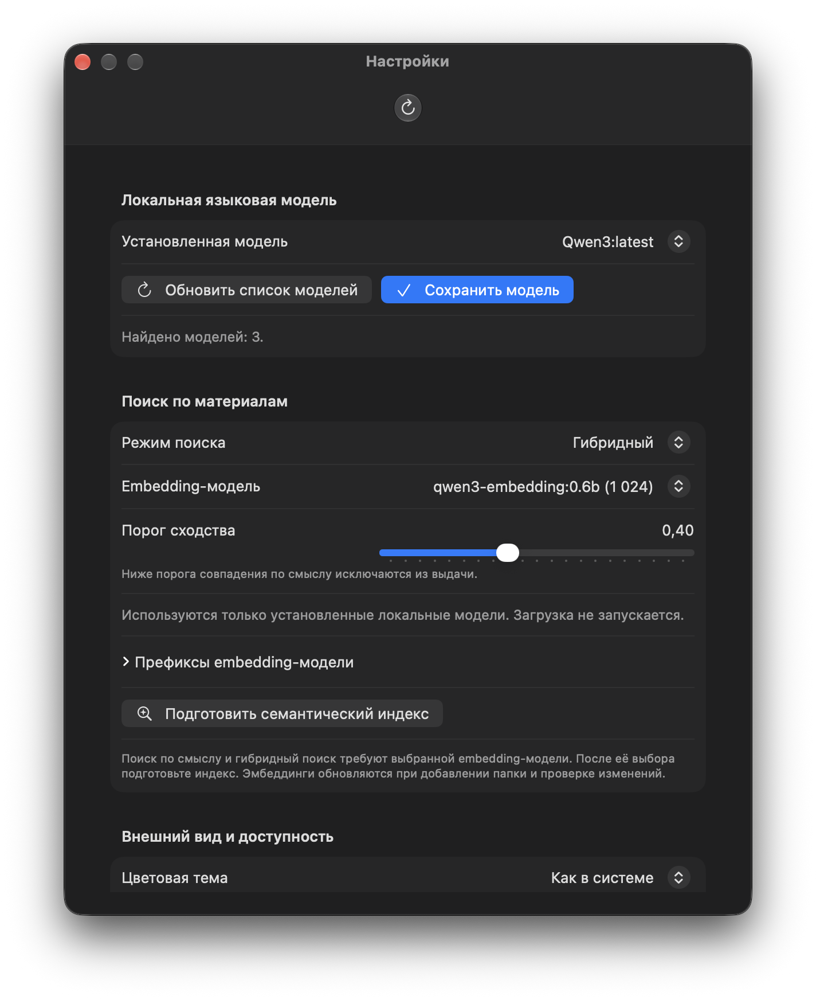

# Study Agent

 · **Free & Open Source**

Study Agent помогает искать в учебных материалах и получать ответы по найденным фрагментам. Библиотека остаётся на компьютере пользователя, а поиск и генерация ответов работают локально.

> **Последний выпуск:** [Study Agent v1 Beta 6.1](https://github.com/gregkorneev-BMSTU/study-agent/releases/tag/v1.0.0-beta.6.1) для macOS 14+ и Apple Silicon. В этой версии Chandra распознаёт каждую страницу PDF, изображения внутри DOCX и локальные изображения из Markdown, включая рукописные пометки рядом с печатным текстом.

## Скачать и установить

[Скачать DMG для macOS](https://github.com/gregkorneev-BMSTU/study-agent/releases/download/v1.0.0-beta.6.1/StudyAgent-v1.0.0-beta.6.1-macos-arm64.dmg) · [Что нового](https://github.com/gregkorneev-BMSTU/study-agent/releases/tag/v1.0.0-beta.6.1) · [SHA-256](https://github.com/gregkorneev-BMSTU/study-agent/releases/download/v1.0.0-beta.6.1/StudyAgent-v1.0.0-beta.6.1-macos-arm64.dmg.sha256).

Откройте DMG и перетащите **Study Agent.app** в **Applications**. При первом запуске мастер поможет подготовить Ollama и локальную языковую модель. Chandra OCR устанавливается отдельно из настроек. DMG не нотариализован Apple, поэтому macOS может показать предупреждение при первом запуске.

## Возможности

- Подключайте выбранные папки с PDF, DOCX, Markdown, текстовыми файлами и изображениями. Индекс обновляется при проверке изменений.
- Ищите по тексту и смыслу, отдельно или в гибридном режиме. Для семантического и гибридного поиска выберите embedding-модель и подготовьте индекс в настройках.
- Получайте ответы локальной языковой моделью по найденным материалам. Без Ollama и модели доступен поиск без генерации ответа.
- Просматривайте использованные фрагменты и переходите к исходному документу; для PDF показывается страница, если её удалось определить.
- Распознавайте печатный и рукописный текст на страницах PDF, во встроенных изображениях DOCX и локальных изображениях, на которые ссылается Markdown. Для OCR установите Chandra в настройках.
- Выбирайте русский или английский язык интерфейса в настройках; доступны светлая и тёмная темы, повышенный контраст и уменьшение движения.

## Предпросмотр

Снимки актуальной версии: мастер первого запуска, библиотека, поиск и настройки.

  

| Первый запуск | Библиотека |
| --- | --- |
|  |  |

| Поиск | Настройки |
| --- | --- |
|  |  |

## Конфиденциальность

Приложение обрабатывает подключённые материалы на этом компьютере и не отправляет их в облачные модели. Учебные папки доступны приложению только после того, как вы сами их добавили. Интернет нужен для загрузки приложения и установки Ollama, моделей и Chandra OCR.

## Руководства

- [Первый запуск](wiki/users/onboarding.md)
- [Настройка локальной модели](wiki/users/model-setup.md)
- [Распознавание документов и Chandra OCR](wiki/users/chandra-ocr.md)
- [Остальная документация Wiki](wiki/README.md)
- **Для разработчиков:** [настройка окружения, запуск, сборка и проверки](wiki/development/README.md)

## Лицензия

Исходный код Study Agent распространяется по [MIT License](LICENSE). Сторонние библиотеки, модели и графические материалы могут иметь отдельные условия; см. [уведомления о сторонних компонентах](THIRD_PARTY_NOTICES.md).
