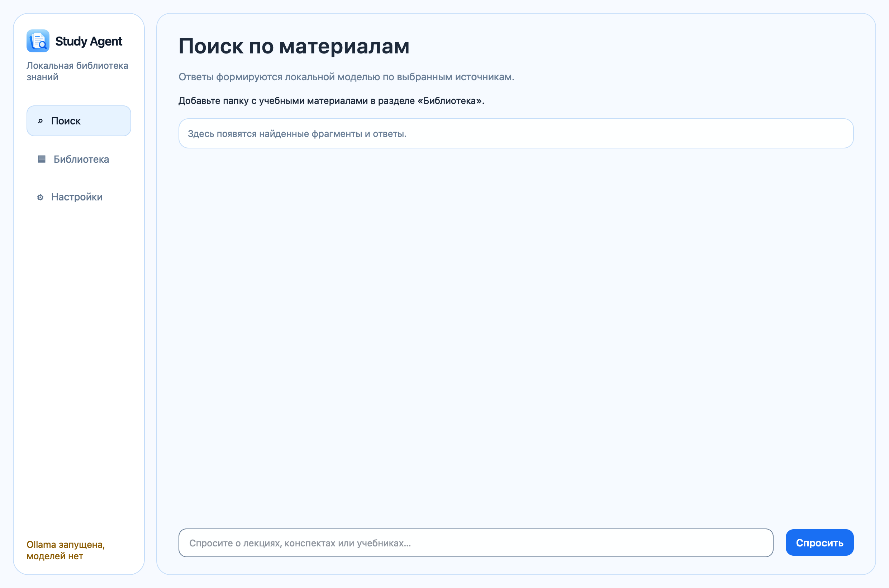
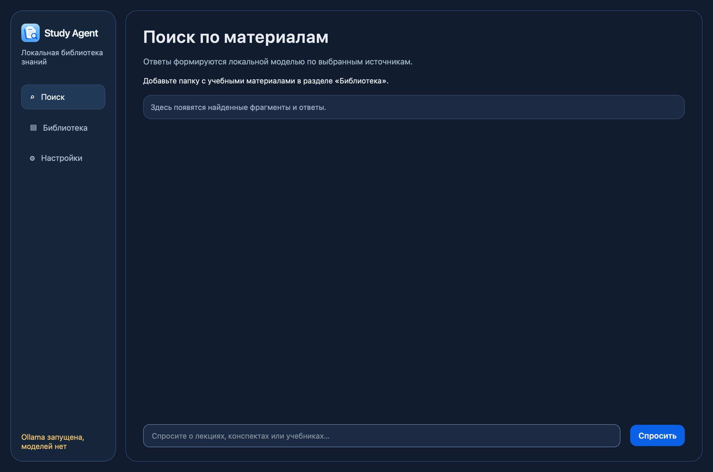
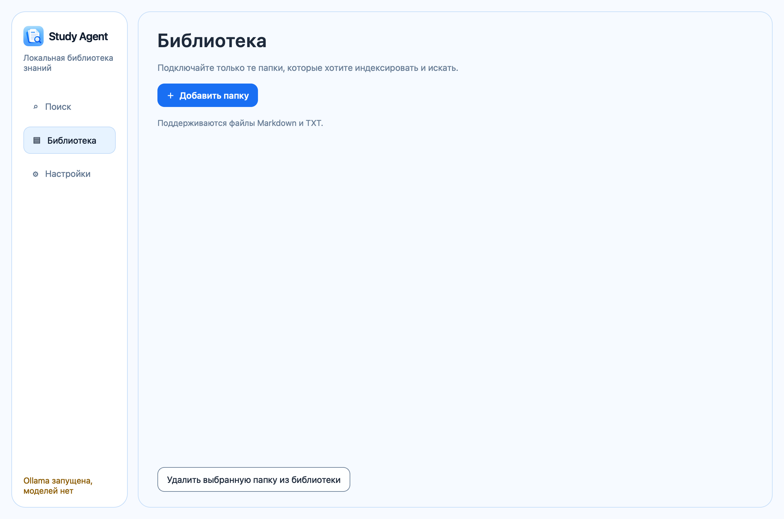
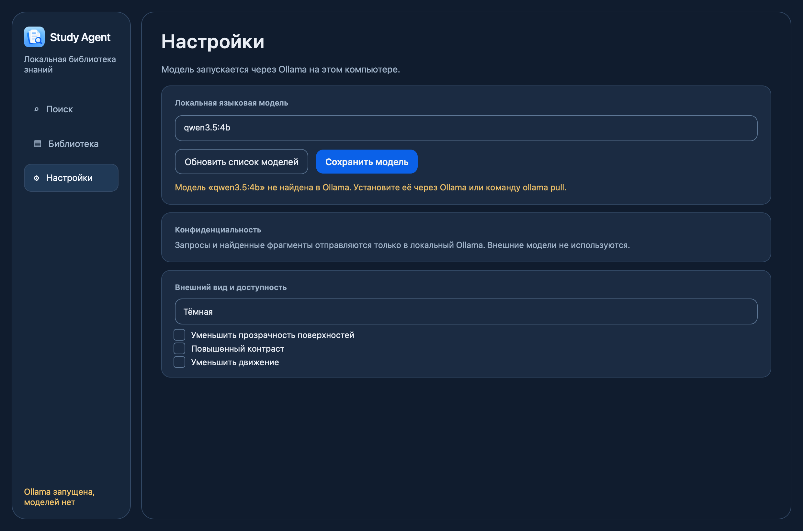

# Study Agent

Локальный агент для поиска и анализа учебных материалов. Цель проекта — настольное приложение для Windows и macOS, которое создаёт персональную базу знаний из выбранных пользователем документов и отвечает на вопросы со ссылками на первоисточники.

> **Статус:** ранний прототип. Уже есть графический интерфейс, выбор папок, локальный поиск по TXT/Markdown и ответы через Ollama. PDF/DOCX, OCR, постоянный индекс, установщики и Windows-проверка пока не реализованы.

## Предпросмотр

Интерфейс использует спокойную фирменную палитру в светлой и тёмной темах, а в заголовке боковой панели показывает логотип из Apple Icon Kit. Скриншоты сняты в macOS при обычном размере окна; в [отчёте QA](artifacts/color-system-qa/README.md) есть также библиотека, настройки, компактное окно и результат поиска с длинным названием файла.

| Светлая тема | Тёмная тема |
| --- | --- |
|  |  |

| Библиотека | Настройки |
| --- | --- |
|  |  |

Локальную сборку `.app` для macOS можно создать по инструкции ниже. Скачать готовый установщик пока нельзя.

## Что планируется

- Подключение одной или нескольких локальных папок через интерфейс.
- Автоматическое индексирование после добавления папки, отслеживание изменений и отчёт о ходе обработки.
- Извлечение текста из документов; Chandra OCR для сканов, изображений и рукописей.
- Локальные эмбеддинги и Qwen для семантического поиска и ответов RAG.
- Ответы только на основании найденных материалов, с названиями документов, фрагментами и страницами. Если данных недостаточно, приложение сообщит об этом.
- Разделы «Поиск», «Библиотека» и «Настройки» в кроссплатформенном интерфейсе.
- Дополнительно — выбранные пользователем материалы каталога IU5Hub и ограниченные MCP-инструменты.

## Что уже есть

- Python-пакет `study_agent` и базовая конфигурация разработки.
- Read-only источник локальной папки для файлов `.txt` и `.md`. Корень задаётся параметром; личные пути не вшиты в исходники.
- CI с проверками pytest и Ruff на Python 3.12 и 3.13.
- Прототип PySide6: выбор папок, поиск по `.txt`/`.md`, локальный ответ модели Ollama и открытие источников.
- Запуск интерфейса для разработки: `python -m study_agent`.
- Архитектурная документация и поэтапный план реализации.

## Сборка приложения macOS

Сборка создаёт автономный `~/Applications/Study Agent.app`; Python и PySide6 пользователю отдельно устанавливать не нужно. На компьютере разработчика выполните из корня репозитория:

```sh
python3.12 -m venv .venv
.venv/bin/python -m pip install '.[packaging]'
./scripts/build_macos_app.sh
open "$HOME/Applications/Study Agent.app"
```

Для локальной разработки bundle можно пересобрать теми же командами. Другой каталог вывода можно задать переменной `APP_OUTPUT_DIR`. Ollama и выбранные модели поставляются отдельно и не включаются в `.app`. Сборка предназначена для архитектуры того Mac, на котором она выполняется. Приложение ad-hoc подписывается для локального запуска; Developer ID подпись и notarization для внешнего распространения ещё не настроены.

Полный предоставленный графический комплект хранится в [`assets/StudyAgent_Apple_Icon_Kit`](assets/StudyAgent_Apple_Icon_Kit). Скрипт сборки использует `macOS/StudyAgent.icns` как иконку приложения; исходная графика, векторные слои и menu bar шаблоны также включены в репозиторий.

## Установка для разработки

Требуется Python 3.12 или новее.

```sh
git clone https://github.com/gregkorneev-BMSTU/study-agent.git
cd study-agent
python3.12 -m venv .venv
```

Активируйте окружение:

```sh
# macOS / Linux
source .venv/bin/activate

# Windows PowerShell
.venv\Scripts\Activate.ps1
```

Установите зависимости разработки и запустите проверки:

```sh
python -m pip install '.[dev]'
pytest
ruff check .
```

Запустите интерфейс в активированном окружении командой `python -m study_agent`. Проверки не загружают модели и не обращаются к пользовательским папкам. Для локальных ответов нужно отдельно установить и запустить Ollama.

Если на macOS при запуске появляется ошибка Qt `Could not find the Qt platform plugin "cocoa"`, из корня проекта активируйте `.venv` и восстановите совместимую ветку Qt:

```sh
source .venv/bin/activate
python -m pip install --force-reinstall --no-cache-dir 'PySide6-Essentials>=6.10.3,<6.11'
```

## Установить локальную модель

Для первого запуска интерфейса установите Ollama и локальную модель `qwen3.5:4b`:

- **macOS:** установите и откройте Ollama с [официальной страницы](https://ollama.com/download), затем в Terminal выполните `ollama pull qwen3.5:4b`.
- **Windows:** установите Ollama с [официальной страницы](https://ollama.com/download/windows), затем в PowerShell выполните `ollama pull qwen3.5:4b`.

Проверить загрузку можно командами `ollama list` и `ollama run qwen3.5:4b`. Модель хранится в Ollama отдельно от проекта и выбирается в разделе «Настройки». См. [Wiki: установка моделей](wiki/model-setup.md).

## Локальные данные и конфиденциальность

Приложение проектируется так, чтобы пользователь сам выбирал папки с материалами. Код не должен зависеть от путей разработчика. Исходные документы, индексы, кэш и модели не следует добавлять в Git. Тестовые данные должны быть синтетическими или обезличенными.

Целевой режим обработки документов и генерации ответов — локальный. Приложение обращается к Ollama на этом компьютере и не использует облачный fallback. Учебные файлы открываются только из папок, которые пользователь явно добавил. Подробности см. в Wiki.

## План разработки

1. Добавить постоянный индекс и автоматическое обновление изменений в выбранных папках.
2. Подключить PDF/DOCX, затем Chandra OCR и локальные эмбеддинги.
3. Улучшить ответы RAG, точность ссылок на страницы и обработку недостатка источников.
4. Проверить интерфейс и сборку на Windows; подготовить Developer ID подпись/notarization/DMG для macOS и установщик Windows.
5. Реализовать дополнительные источники и MCP-инструменты после стабилизации основного потока.

## Документация

- [Wiki проекта](wiki/README.md)
- [Требования](wiki/requirements.md)
- [Архитектура](wiki/architecture.md)
- [Дорожная карта](wiki/roadmap.md)
- [Текущее состояние](wiki/current-state.md)
- [Установка моделей](wiki/model-setup.md)
- [Решения и открытые вопросы](wiki/decisions/README.md)
- [Тестирование и CI](wiki/testing.md)
