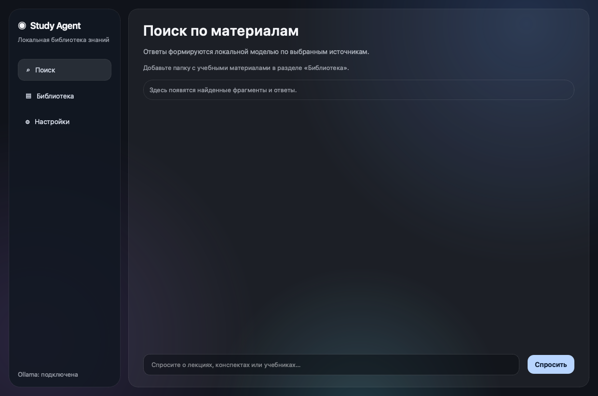
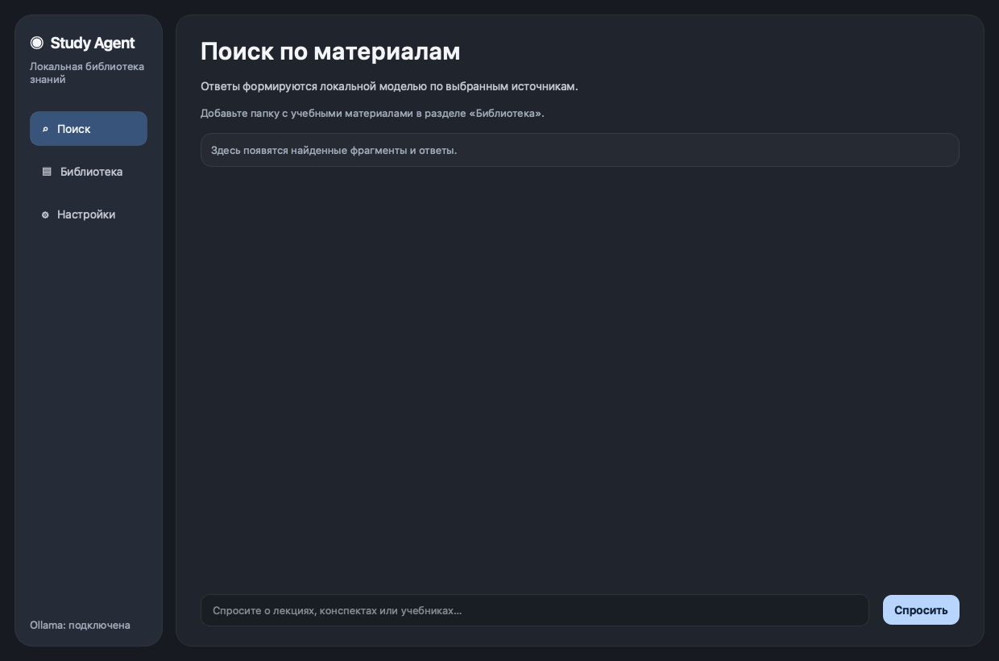
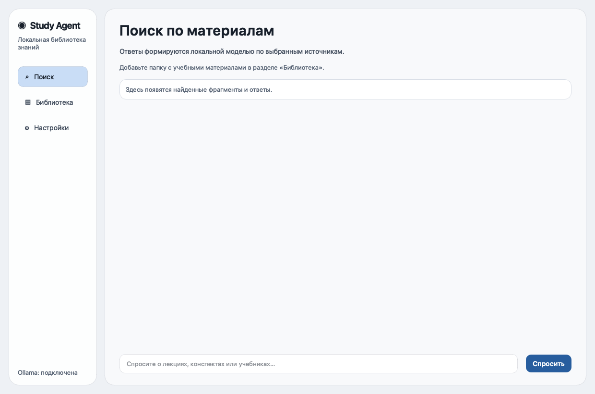

# Liquid Glass UI QA

The screenshots capture the application at 1240×820 in dark/light themes and at the supported minimum size, 760×560. Screenshots contain the empty library state and no selected user folders or document paths.

## Before and after

Baseline: commit `65c2619`, dark search view.

Updated dark search view:

Updated light search view:

The updated design removes the three large background radial gradients, reduces the visual weight of the content area, and reserves translucent material for the navigation surface. Search content and result cards remain opaque for readability.

## Other views

- [Dark library view, 1240×820](after-dark-library-1240x820.png)
- [Dark settings view, 1240×820](after-dark-settings-1240x820.png)
- [Compact settings view, 760×560](after-compact-settings-760x560.png)
- [Accessibility controls, 760×560](after-accessibility-controls-760x560.png)

## Runtime and accessibility checks

Interactive Cocoa runtime smoke check on macOS, using the installed PySide6 6.10.3 platform plugin and current source via `PYTHONPATH=src`:

- All three navigation destinations selected the matching page and nav control.
- System, light, and dark theme values applied; light theme set the expected canvas and text tokens.
- Reduced transparency removed translucent RGBA fills; high contrast applied stronger borders and focus color.
- Enabling reduced motion stopped an in-progress transition and restored full page opacity.
- Both scroll areas retained transparent viewports and content widgets.
- Compact layout screenshots show the settings remain reachable by scrolling at 760×560.
- A QtTest Tab-key pass moved keyboard focus from the navigation control into the content area and onward to the search input.
- No continuous animation, shader, or backdrop blur was added.

These checks verify application states and basic keyboard traversal. They are not a screen-reader audit. VoiceOver and Windows accessibility automation were not run.

## Raster timing

Measured synchronously in the same Python process with Qt 6.10.3 Cocoa, at a fixed 1240×820 size. Each version received 20 warmups, followed by 300 `Canvas.render` samples and 160 `QWidget.grab` samples.

| Measurement | Baseline `65c2619` mean / p95 | Updated mean / p95 |
| --- | ---: | ---: |
| `Canvas.render` | 1.7855 / 2.0271 ms | 1.5131 / 1.9407 ms |
| `QWidget.grab` full window | 4.8843 / 5.1151 ms | 4.3363 / 4.7717 ms |

These are local synchronous raster timings, not frame-rate, GPU composition, energy, or cross-device measurements. They do not prove 60 FPS.
