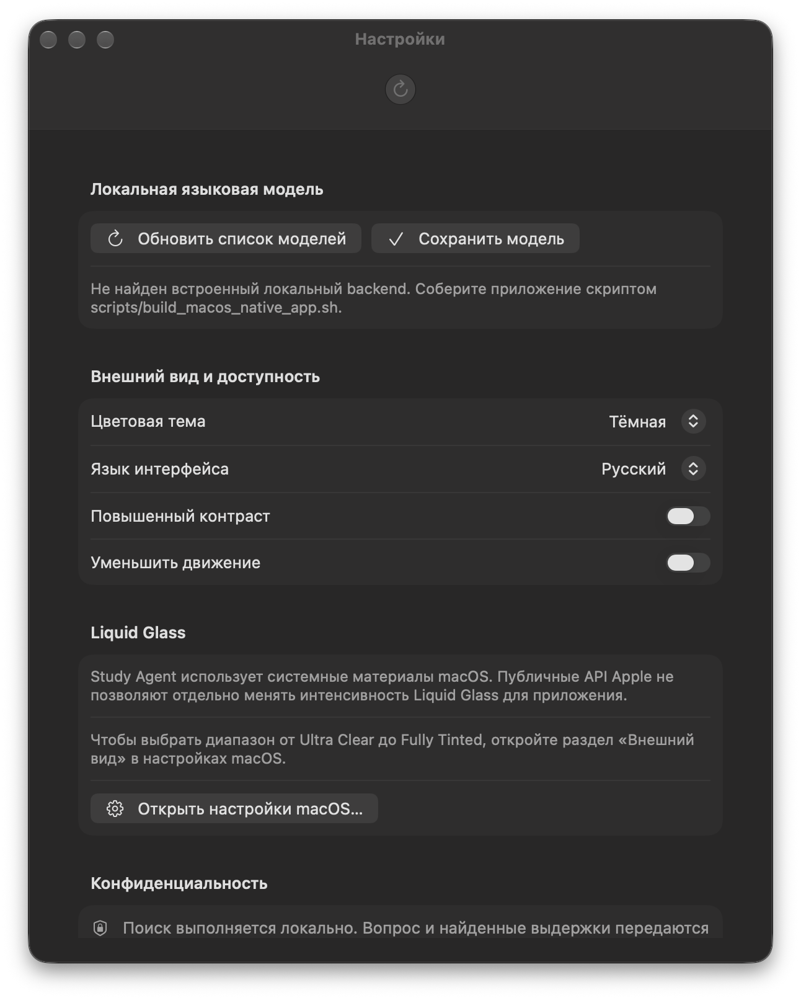

# macOS Liquid Glass settings QA

## API review

Reviewed Apple's [macOS 27 Appearance guide](https://support.apple.com/en-mt/guide/mac-help/mchlp1225/27/mac/27), [macOS 27 release notes](https://support.apple.com/en-us/127257), [WWDC26 Platforms State of the Union](https://developer.apple.com/videos/play/wwdc2026/102/), [Adopting Liquid Glass](https://developer.apple.com/documentation/technologyoverviews/adopting-liquid-glass), SwiftUI [`Glass`](https://developer.apple.com/documentation/swiftui/glass) and [custom glass effects](https://developer.apple.com/documentation/swiftui/applying-liquid-glass-to-custom-views), AppKit [`NSGlassEffectView`](https://developer.apple.com/documentation/appkit/nsglasseffectview) and its [`tintColor`](https://developer.apple.com/documentation/appkit/nsglasseffectview/tintcolor), [`NSVisualEffectView`](https://developer.apple.com/documentation/appkit/nsvisualeffectview), and SwiftUI's [`accessibilityReduceTransparency`](https://developer.apple.com/documentation/swiftui/environmentvalues/accessibilityreducetransparency) and [`accessibilityShowBorders`](https://developer.apple.com/documentation/swiftui/environmentvalues/accessibilityshowborders).

The reviewed public APIs do **not** expose a numeric value for macOS's Liquid Glass slider, nor a continuous per-app intensity control. SwiftUI `Glass` exposes `regular`, `clear`, and `identity` variants plus `tint(_:)`; AppKit `NSGlassEffectView` exposes a glass style, tint color, and corner radius. Tint changes color, not the system slider value or a documented transparency coefficient. The app therefore does not invent a percentage scale or custom slider.

## Implemented behavior

- Settings includes a **Liquid Glass** section explaining that native macOS materials remain system-controlled.
- The action opens the System Settings app; the user can select **Appearance** there. No undocumented deep link or preference key is used.
- When SwiftUI reports Reduce Transparency, the section explains that the accessibility preference takes priority.
- The existing native sidebar, toolbar, standard controls, and window materials are not replaced or overlaid. There are no custom Liquid Glass surfaces in the app that need a local intensity setting.
- macOS 27's system slider remains the only intensity control. Study Agent follows the native material behavior; it does not read or change macOS's private slider state.

## Compatibility and accessibility

The app deployment target remains macOS 14. Liquid Glass-specific user guidance is conditioned on macOS 27 availability; older supported systems receive a fallback explanation. Reduce Transparency, contrast, appearance, active-window behavior, and material rendering remain delegated to macOS. Existing native form controls remain keyboard- and VoiceOver-operable.

## QA results

Screenshot is captured from the actual running Xcode Release app on this Mac, not generated from the reference image:

- Host: macOS 27.0.1 (26A434); Xcode 27.1, macOS SDK 27.0.
- Xcode Debug build: succeeded.
- Xcode Release build: succeeded.
- `ruff check .`: passed.
- `.venv/bin/pytest --ignore=tests/test_switch.py`: 31 passed.
- Full `.venv/bin/pytest` aborts during `tests/test_switch.py` QApplication initialization in this host's Cocoa/Qt environment. The remaining test suite passes when that test module is excluded; no source changes were made to hide or alter this environment issue.
- The screenshot shows the real Settings view. Since it was launched directly from Xcode without packaging the Python helper, it also displays the existing backend-unavailable status; this does not test the packaged backend.
- The System Settings button is implemented with AppKit's bundle-identifier lookup and `NSWorkspace.open`; a click-through check was not completed in this run.
- System slider extremes and intermediate positions were not changed or compared because they are global macOS preferences. The app does not read or modify that preference.
- Reduce Transparency, Increase Contrast, and Show Borders were not toggled for visual comparisons. The SwiftUI view responds to the Reduce Transparency environment value and leaves native material rendering under macOS control.
- macOS 14/15/26 were not available for this run; deployment target remains 14.0, but minimum-OS execution was not verified here.
- No continuous effects, timers, or custom blur were added. CPU/GPU profiling and FPS measurements were not performed, so no performance numbers are claimed.

## Limitations

Apple documents the system slider and native glass variants, but does not document a public API for reading the slider's numeric position or setting a per-app intensity. The settings page intentionally links to System Settings instead of imitating the system slider with opacity, tint, or a non-functional custom control.
