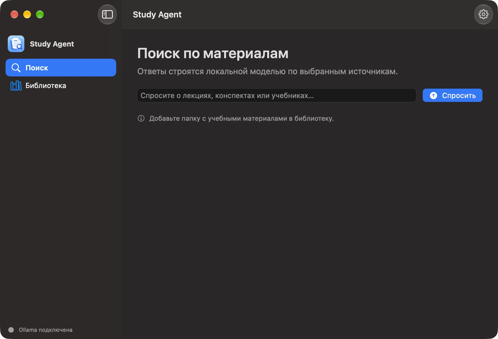
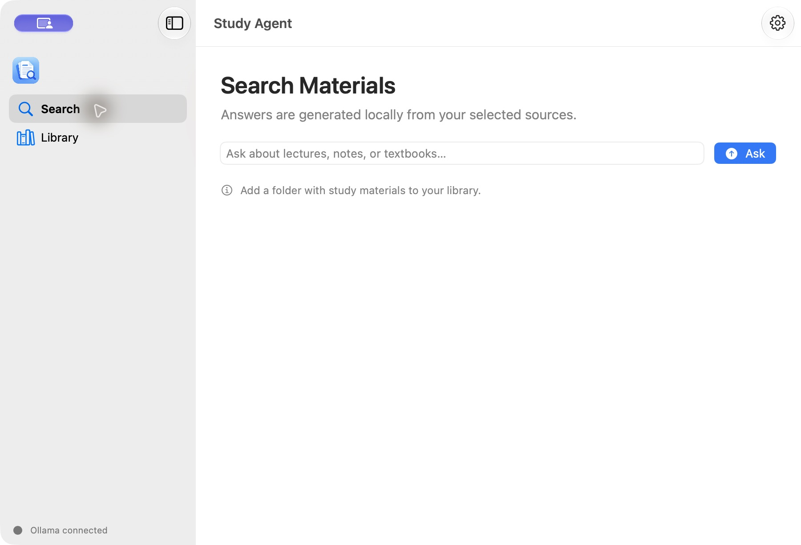
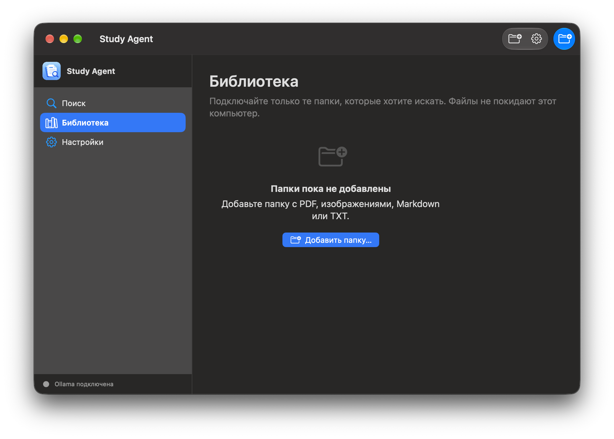
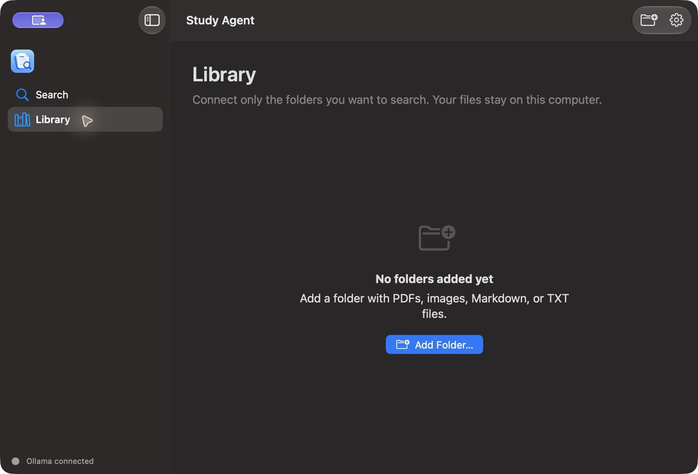
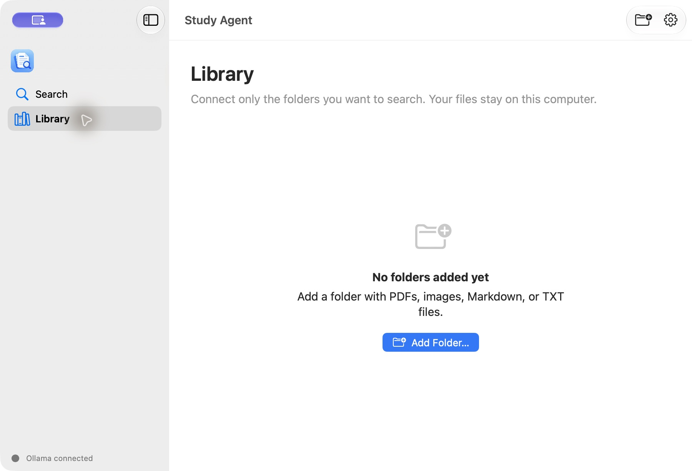
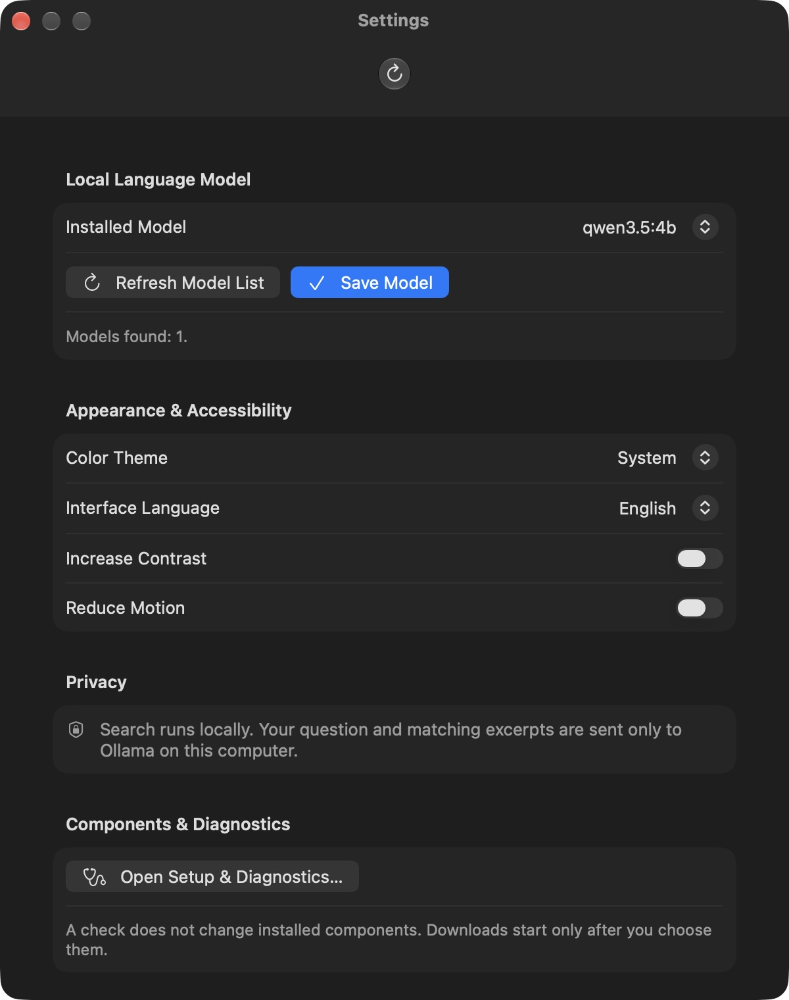
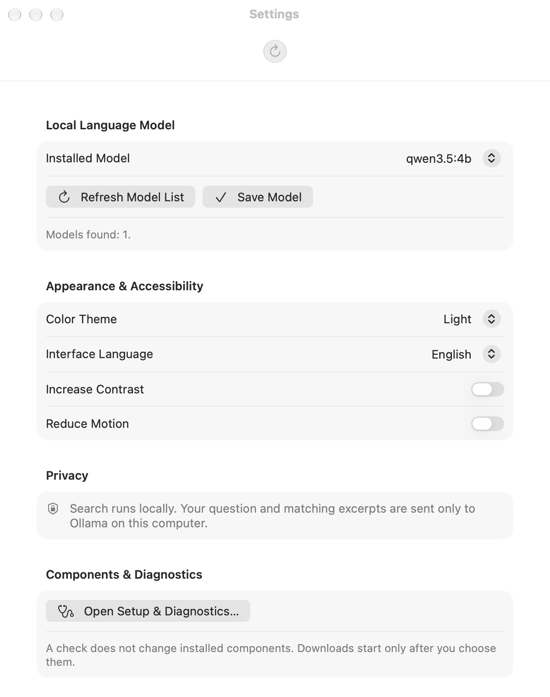
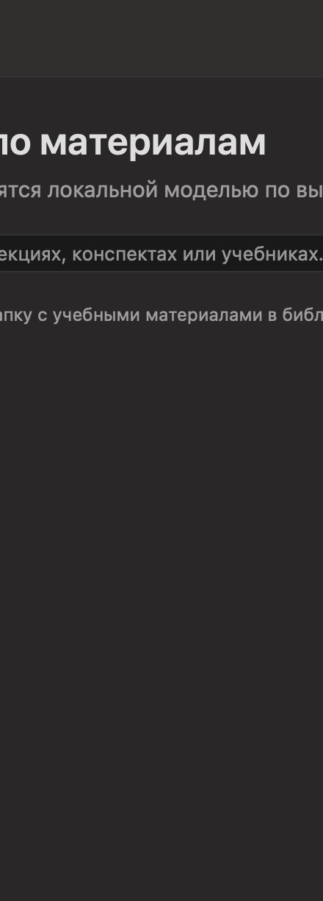

# macOS Liquid Glass UI review

QA run: 2026-10-24 · Xcode 27.1 · macOS SDK 27.0 · macOS 27.0.1 arm64.

## Findings and changes

- The old `HSplitView` assembled a sidebar manually and did not expose native split-view behavior such as the system sidebar toggle. The documented earlier `NavigationSplitView` blank-detail issue was not reproducible with this current Xcode/macOS runtime: both Search and Library rendered in the real app, and the accessibility tree contained the detail content. The main window now uses `NavigationSplitView` and a standard sidebar `List`.
- The sidebar keeps the Study Agent app mark and visible product name, plus Ollama status. Settings are opened through the system Settings scene and no longer appear as a third sidebar destination.
- Add Folder previously appeared in both the root toolbar and the Library toolbar. The action now appears once in the toolbar when Library is selected; the contextual empty-state action remains available.
- Search, Library, Settings, SF Symbols and standard SwiftUI controls keep their content surfaces. No custom blur, glass overlay, gradient, or continuous decorative animation was added. On macOS 26 and later, the system supplies the material for native navigation and toolbar surfaces; on macOS 14–25 the semantic controls use the system appearance available there.
- App Reduce Motion now also observes the macOS Reduce Motion environment value. App contrast preference now combines with the system increased-contrast environment.

## Before and after

The “before” captures are the real native Beta 2 README screenshots. “After” captures were taken from a separately identified and signed QA copy of the Release app while running on this Mac. The QA copy uses the same app code and packaged helper; it did not replace `/Applications/Study Agent.app`.

| Section | Before | After |
| --- | --- | --- |
| Search · dark |  |  |
| Search · light | — |  |
| Library · dark |  |  |
| Library · light | — |  |
| Settings · dark |  |  |
| Settings · light | — |  |
| Sidebar · dark | — |  |
| Sidebar · light | — |  |

The search/library captures show the empty-source state; they are real UI captures, not mockups. Sidebar close-ups are crops of those captures. A minimum-window screenshot could not be retained; the minimum supported window size remains 760 × 560 points in code and the app prevents resizing below it.

The dark Search and sidebar captures were refreshed after the follow-up added the visible “Study Agent” name next to the app icon. Other screenshots document the base Liquid Glass refresh and predate that branding-only adjustment.

## Apple guidance and API choices

- [Adopting Liquid Glass](https://developer.apple.com/documentation/technologyoverviews/adopting-liquid-glass) — use standard controls and let the system style navigation and toolbars.
- [HIG: Materials](https://developer.apple.com/design/human-interface-guidelines/materials) — keep Liquid Glass in the functional layer and content on readable surfaces.
- [HIG: Sidebars](https://developer.apple.com/design/human-interface-guidelines/sidebars) — use semantic sidebar lists and support adaptive visibility.
- [NavigationSplitView](https://developer.apple.com/documentation/swiftui/navigationsplitview) — native split navigation.
- [HIG: Toolbars](https://developer.apple.com/design/human-interface-guidelines/toolbars) — group concise, contextual actions in the system toolbar.

No new glass-specific API was needed: `NavigationSplitView`, `.listStyle(.sidebar)`, `ToolbarItem`, `SettingsLink`, SF Symbols, and system controls provide the platform-native material. `NSVisualEffectView` was unnecessary. This avoids using APIs unavailable on the macOS 14 deployment target.

## Compatibility and verification

- Project deployment target remains macOS 14. Debug and Release arm64 Xcode builds succeeded with macOS SDK 27.0; emitted target remained `arm64-apple-macos14.0`.
- Runtime verification was performed only on macOS 27.0.1. macOS 14 and 15 were not available for a runtime check.
- The separately packaged Release QA app passed `codesign --verify --deep --strict` and launched. Manual UI review confirmed Search/Library navigation, the empty Library view, the system sidebar toggle, one Add Folder toolbar action, and the Settings scene. Both appearance themes were captured.
- `.venv/bin/ruff check .` passed. `.venv/bin/pytest --ignore=tests/test_switch.py` passed: **31 passed**.
- The full `.venv/bin/pytest` run aborted in `tests/test_switch.py` while its fixture created Qt `QApplication`; macOS displayed “Python unexpectedly quit” (the attached alert). This is the repository’s known local Qt Cocoa/platform-plugin failure and is separate from launching the native SwiftUI app. The UI task explicitly leaves Python and Qt implementation unchanged. The failing test was not rerun after the abort.
- GitHub PR CI run [40126927774](https://github.com/gregkorneev-BMSTU/study-agent/actions/runs/40126927774) failed in both Python 3.12 and 3.13 at `tests/test_ocr_model.py`: the test imports `tqdm.auto`, but the workflow installs `.[dev]` without the optional OCR extra. Ruff did not run after pytest failed. This is outside the macOS UI diff and was not masked by skipping unrelated tests in CI.
- No XCTest/UI automation target exists. VoiceOver, physical macOS 14/15, system Reduce Transparency, system Reduce Motion, alternate Accent Colors, and keyboard-only navigation were not exercised end-to-end. The related native SwiftUI controls/environments are used, but that is not a substitute for those checks.
- CPU, memory, and frame rate were not measured. No FPS claim is made. No custom GPU blur, timer, or continuous animation was introduced.

## Files changed

- `macOS/StudyAgent/ContentView.swift`
- `macOS/StudyAgent/StudyAgentApp.swift`
- `macOS/StudyAgent/StudyAgentModel.swift`
- `wiki/design-system.md`
- `wiki/architecture.md`
- `wiki/current-state.md`
- `wiki/testing.md`
