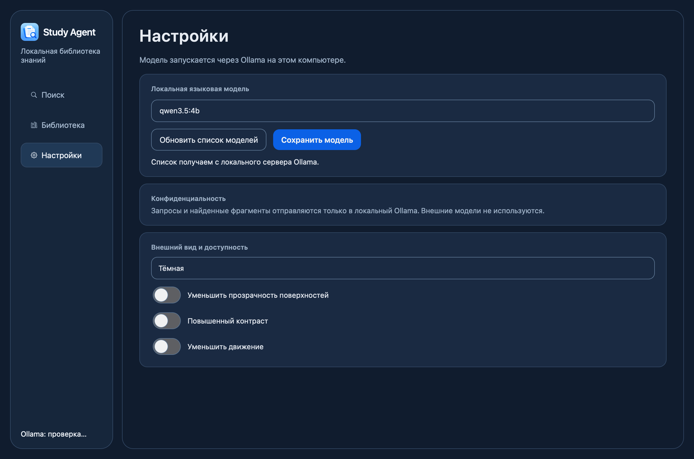
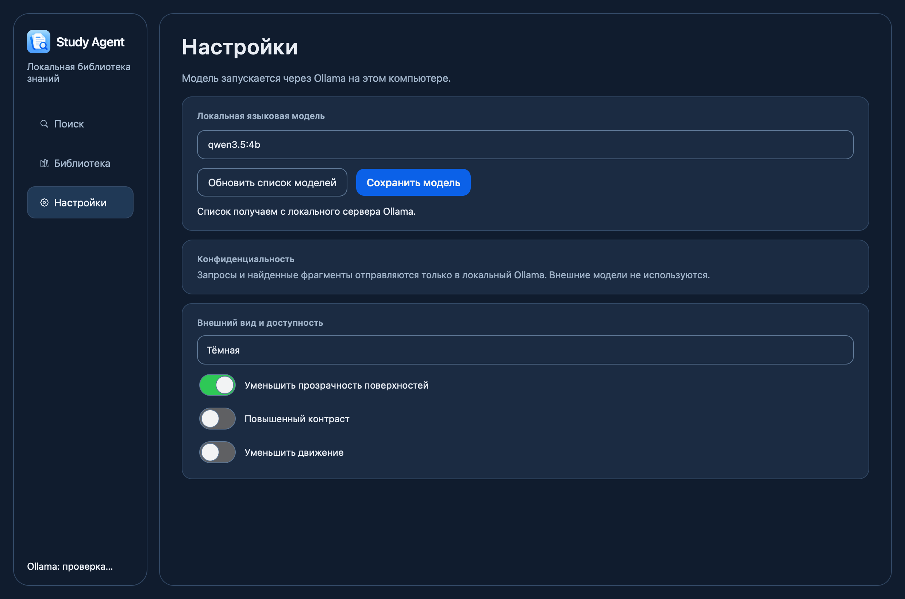
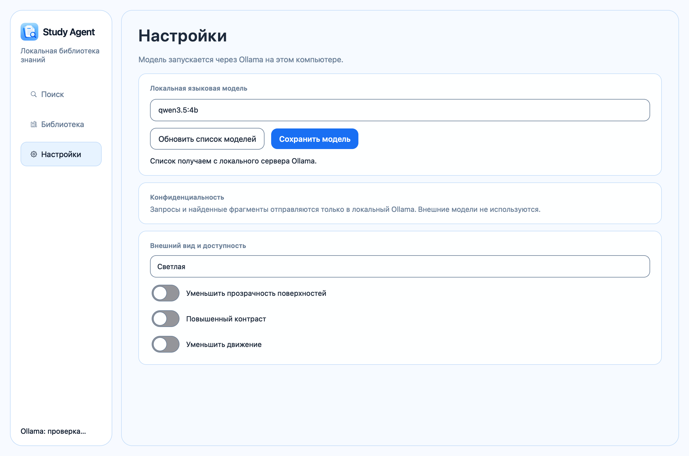
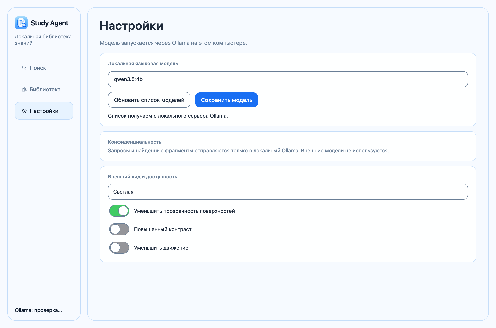
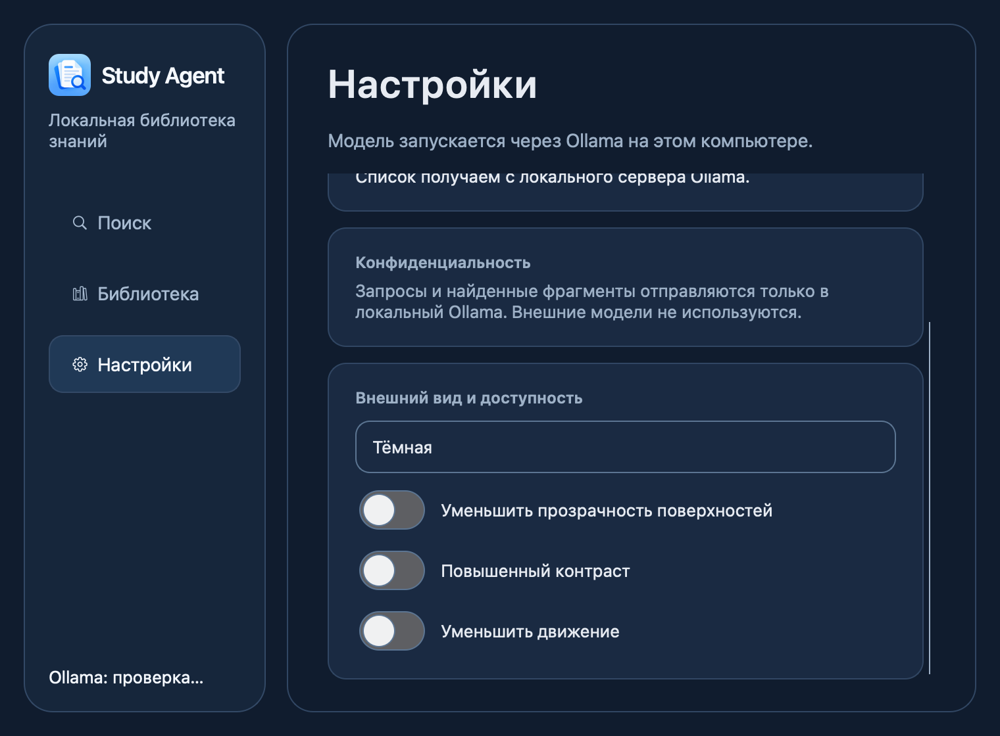

# AppleSwitch visual QA

macOS Cocoa captures of the settings screen at 1240×820. The first accessibility toggle is shown OFF and ON in each app theme. QA uses an isolated temporary `QSettings` store and mocks the Ollama model-list request; it does not alter saved user preferences or access personal folders.

| App theme | OFF | ON |
| --- | --- | --- |
| Dark |  |  |
| Light |  |  |

Functional checks are in `tests/test_switch.py` and `tests/test_theme.py`. The captures demonstrate layout and rendering, not frame-rate measurements or VoiceOver behavior. Windows is not available for this verification.

Compact layout at the current 760×560 minimum window size:

