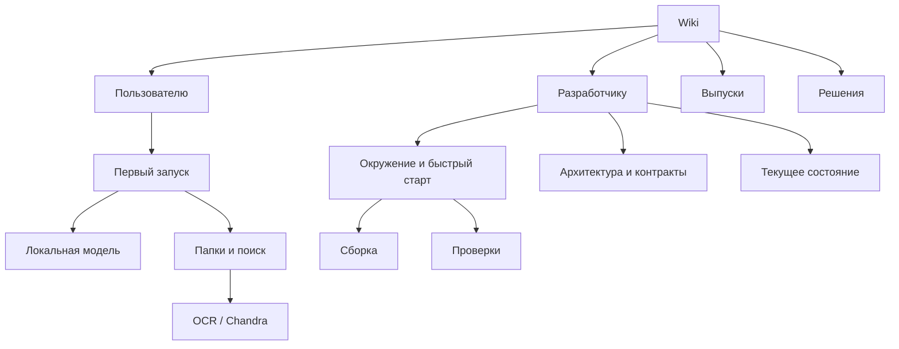

# Wiki Study Agent

Домашняя страница документации проекта. Ссылки сделаны обычным Markdown: они работают в GitHub и Obsidian. Для Obsidian откройте корень репозитория как хранилище (vault), затем начните с этой страницы.

## Выберите свой маршрут

- **[Пользователю](users/README.md)** — первый запуск, локальные модели, распознавание документов и ответы на частые вопросы.
- **[Разработчику](development/README.md)** — настройка окружения, запуск и сборка приложения, тестирование, устройство проекта и рабочие процессы.
- **[Выпуски](releases/README.md)** — заметки к версиям и проверенные ограничения сборок.
- **[Решения](decisions/README.md)** — принятые архитектурные решения и открытые вопросы.

Для агентов отдельная [техническая карта и правила чтения документов](development/README.md#маршрут-для-ии-агента).

## Для быстрого поиска

- [Требования](development/requirements.md) · [Архитектура](development/architecture.md) · [Текущее состояние](development/current-state.md)
- [Индексация документов](development/document-indexing.md) · [Поиск и RAG](development/sa-03-search.md) · [Эмбеддинги](development/sa-03-embeddings.md)
- [Тестирование](development/testing.md) · [Сборка и выпуск macOS](development/macos-release.md)

## Как поддерживать Wiki

При изменениях обновляйте тематическую страницу и соответствующий индекс. Отделяйте опубликованные возможности от планов и результатов незавершённой работы; указывайте, что проверено, где и с какими ограничениями. Не переносите неподтверждённые предположения в раздел принятых решений.
