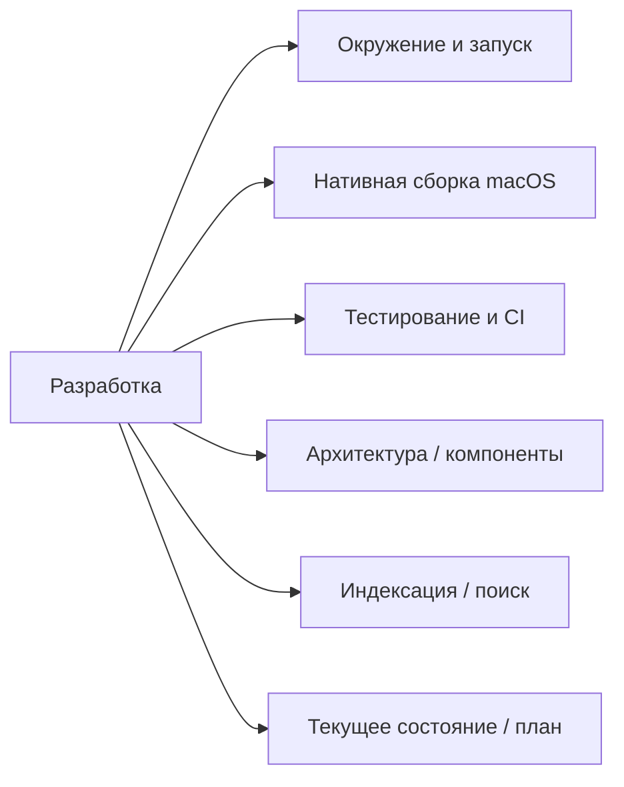

# Разработка Study Agent

Здесь собраны быстрый старт, сборка и техническая документация. Пользовательские инструкции находятся в [разделе для пользователей](../users/README.md). Вернуться к [главной карте Wiki](../README.md).



## Навигация

- [Требования](requirements.md) · [Архитектура](architecture.md) · [Компоненты](components.md) · [Контракт backend](backend-protocol.md)
- [Индексация документов](document-indexing.md) · [Поиск SA-03](sa-03-search.md) · [Эмбеддинги](sa-03-embeddings.md)
- [Нативная индексация macOS](macos-indexing-ui.md) · [Дизайн-система](design-system.md) · [Извлечение DOCX](docx-extraction-review-fixes.md)
- [Текущее состояние](current-state.md) · [Дорожная карта](roadmap.md) · [Окружение](environment.md)
- [Тестирование](testing.md) · [Сборка и выпуск macOS](macos-release.md) · [Chandra OCR](chandra-ocr.md) · [Настройка моделей](model-setup.md) · [Welcome Experience](onboarding.md) · [Windows](windows.md)

## Маршрут для ИИ-агента

- Для фактического состояния `main`, незавершённых задач и границ проверки начните с [текущего состояния](current-state.md). Оно хронологическое: записи о локальных ветках не означают, что функция вошла в опубликованный выпуск.
- Для подтверждённых возможностей конкретной сборки используйте её [release notes](../releases/README.md).
- Для целевого поведения и ограничений используйте [требования](requirements.md); они описывают цель и сами по себе не подтверждают реализацию.
- Для устройства системы и различения текущего кода от целевой архитектуры используйте [архитектуру](architecture.md).
- Перед крупными изменениями прочитайте требования, архитектуру и текущее состояние; затем откройте соответствующую техническую страницу из навигации выше.

## Быстрый старт Python

Требуется Python 3.12 или новее. Из корня репозитория создайте окружение и установите зависимости:

```sh
git clone https://github.com/gregkorneev-BMSTU/study-agent.git
cd study-agent
python3.12 -m venv .venv
```

Активируйте окружение и установите пакет с зависимостями разработки:

```sh
# macOS / Linux
source .venv/bin/activate

# Windows PowerShell
.venv\Scripts\Activate.ps1

python -m pip install '.[dev]'
```

Запустить Python/PySide6-интерфейс можно командой:

```sh
python -m study_agent
```

Проверки проекта:

```sh
pytest
ruff check .
```

Стандартные тесты не загружают модели и не читают пользовательские папки. Инструкции по установке OCR-зависимостей и ограничениям Chandra приведены в [Wiki: Chandra OCR](chandra-ocr.md).

Если на macOS появляется ошибка Qt `Could not find the Qt platform plugin "cocoa"`, в активированном `.venv` восстановите совместимую версию Qt:

```sh
python -m pip install --force-reinstall --no-cache-dir 'PySide6-Essentials>=6.10.3,<6.11'
```

## Нативная сборка macOS

Нативный клиент реализован на SwiftUI/Xcode, Python backend упаковывается отдельным PyInstaller helper внутри приложения. Откройте `macOS/StudyAgent.xcodeproj` в Xcode или соберите `.app` из корня репозитория на macOS с Xcode Command Line Tools:

```sh
python3.12 -m venv .venv
.venv/bin/python -m pip install '.[packaging,ocr]'
./scripts/build_macos_native_app.sh
open "$HOME/Applications/Study Agent.app"
```

По умолчанию приложение создаётся в `~/Applications`; путь можно изменить через `APP_OUTPUT_DIR`. Минимальная поддерживаемая версия macOS — 14. Для сборки DMG используйте `./scripts/build_macos_dmg.sh`; режимы, подпись, notarization и проверка опубликованного пакета описаны в [инструкции по выпуску macOS](macos-release.md).

Пользовательские настройки языка и интерфейса проверяются в самой сборке приложения. В macOS-клиенте язык ответа локальной модели следует выбранному языку интерфейса.

## PySide6 и Windows

PySide6 GUI остаётся кроссплатформенным Python-интерфейсом и путём разработки. macOS-дистрибутив собирается как нативное SwiftUI-приложение. Проверенная Windows-сборка и Windows-дистрибутив не входят в Beta 6.1; актуальные результаты и ограничения указаны в [состоянии проекта](current-state.md).

PySide6 запускает индексацию в фоне после добавления папки. Поиск ожидает завершения текущих операций библиотеки и обновляет изменившиеся документы; удаление папки удаляет её записи из локального индекса.

## Ресурсы и значки

Полный предоставленный графический комплект хранится в [`assets/StudyAgent_Apple_Icon_Kit`](../../assets/StudyAgent_Apple_Icon_Kit). Xcode-проект ссылается на ICNS и PNG внутри комплекта, чтобы не хранить дубликаты.

Пользовательские документы, базы, индексы, кэш, модельные веса и персональные абсолютные пути не добавляются в Git. Для проверок используйте синтетические или разрешённые обезличенные данные.

## CI и связанные документы

CI запускает `pytest` и `ruff check .` на поддерживаемых версиях Python. Отдельные проверки упаковки macOS и OCR описаны в [тестировании](testing.md).

- [Требования](requirements.md) и [архитектура](architecture.md)
- [Текущее состояние](current-state.md) и [дорожная карта](roadmap.md)
- [Тестирование и CI](testing.md)
- [macOS: сборка и выпуск](macos-release.md)
- [Правила работы Codex](../../AGENTS.md)

## Git и публикация

Рабочая ветка и публикация определяются корневым `AGENTS.md` и указаниями пользователя для конкретной задачи. Перед коммитом проверьте `git diff`, `git status` и список файлов, добавляемых в индекс. Не коммитьте пользовательские материалы, модели, базы, индексы, кэш или `.env`. Не переписывайте опубликованную историю и не используйте force push.
